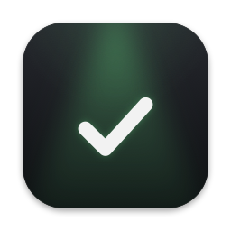
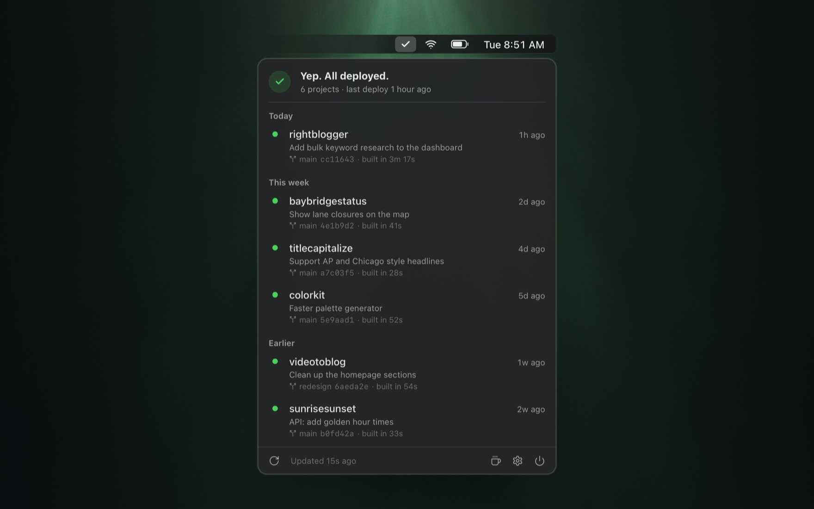
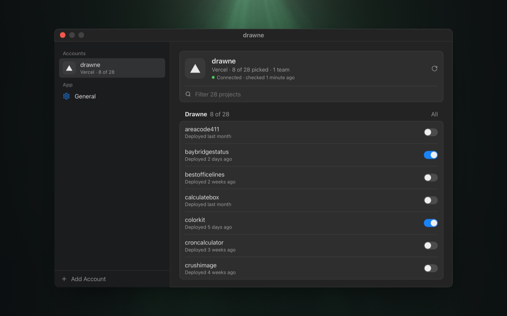
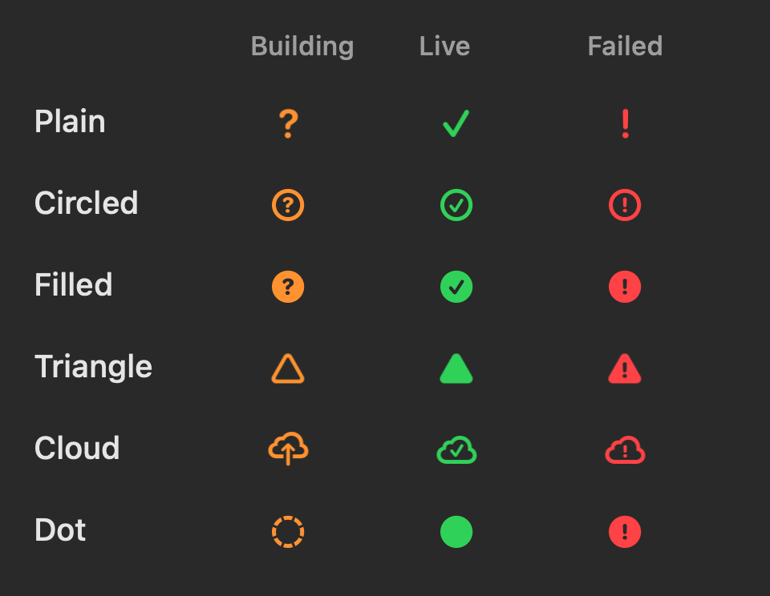

<p align="center">
  
</p>

<h1 align="center">Deployed Yet?</h1>

<p align="center">A free, open-source Mac menu bar app that answers one question: did it ship?</p>

<p align="center">
  <a href="https://github.com/someguy9/deployedyet/releases/latest"></a>
  
  <a href="LICENSE"></a>
</p>

<p align="center">
  <a href="https://github.com/someguy9/deployedyet/releases/latest/download/DeployedYet.dmg"><b>Download for macOS</b></a> · <a href="https://deployedyet.com">deployedyet.com</a>
</p>

<p align="center">
  
</p>

- Add as many Vercel, Cloudflare (Workers and Pages) and GitHub Actions accounts as you have, then pick which projects to watch.
- The menu bar shows `?` while something is building, `✓` once it's live and `!` if it broke. It turns amber while building, green for a few minutes after a deploy lands, and red while anything is failing. There are six icon styles, and you can hide the icon until something needs you.
- Each project shows its newest tracked deploy and any older deploys still building, so concurrent builds remain visible and watchable. Failed deploys sit at the top, then builds, then the rest by date. Each row shows the branch, short commit and build time.
- Search tracked deployment rows by project, team, account, branch, commit, message or provider, and combine provider and state filters. Clear resets them; the menu shows the matching count while the headline and monitoring warnings stay global.
- Collapse project groups in Settings to keep large accounts manageable, or collapse and expand all groups at once. Search reveals matching groups without losing your saved collapsed state.
- You can get a notification when a deploy fails or production goes live. Click the bell on a single build to hear when that one finishes.
- It checks every 5 seconds while something is building and once a minute otherwise. When it gets rate limited it backs off, and it catches up when your Mac wakes. Opening the menu checks right away, and if you turn on "Check right after I push", a push from your Mac shows up within seconds.

<p align="center">
  
  <br><sub>Pick exactly which projects each account tracks.</sub>
</p>

<p align="center">
  
  <br><sub>Six icon styles, in the menu's own colors.</sub>
</p>

## Tokens and privacy

The app only reads, so give each token the smallest set of permissions it'll accept:

| Provider | Token | Permissions |
| --- | --- | --- |
| Vercel | [Account token](https://vercel.com/account/tokens) | Vercel has no read-only tokens yet. Make one per team and give it an expiry date. |
| Cloudflare | [Custom API token](https://dash.cloudflare.com/profile/api-tokens) | Read on Account Settings, Workers Scripts, Workers Builds Configuration (git builds) and Cloudflare Pages |
| GitHub | [Fine-grained token](https://github.com/settings/personal-access-tokens/new) | Read on Actions and Metadata, for the repos you deploy from |

Tokens live in your Mac's Keychain, on this device only. They never get written anywhere else or logged, and they're only sent to `api.vercel.com`, `api.cloudflare.com` or `api.github.com` over HTTPS. Removing an account deletes its token.

To make the menu fill in instantly, the app caches project names, branches and commit messages in `~/Library/Application Support/DeployedYet/`. There's no account to sign up for and no crash reporting. Optional usage analytics is **on by default** in configured release builds and can be disabled in Settings → General → Privacy. Unless you opt out, with a configured build, the app sends a small allowlist of usage events directly to PostHog, using a random installation identifier rather than your account identity. Tokens, project names, repositories, paths, URLs, branches, commit messages, and error text never enter analytics. Turning analytics off discards queued events and removes the local identifier; already-sent events remain in PostHog. PostHog necessarily sees the network address of incoming requests; the app disables location enrichment.

See [Analytics setup](docs/analytics.md) for project configuration, the event catalog, and DAU/retention dashboard recipes. The production capture token is configured. Debug analytics is disabled.

"Check right after I push" is off until you pick a folder. It watches that folder for git pushes by reading only the last line of git's push log (`.git/logs/refs/remotes/`). It never runs git, never reads your code, and sends nothing anywhere; a push just makes the app check sooner.

Updates come through [Sparkle](https://sparkle-project.org). Once a day the app downloads `appcast.xml` from the latest GitHub release, with no tokens and no system profile. A newer version is downloaded in the background, checked against the update key, and swapped in while nothing is building. You can turn this off in General.

## Build from source

You need Xcode and [Tuist](https://tuist.dev) (`brew install tuist`).

```bash
git clone https://github.com/someguy9/deployedyet
cd deployedyet
app/run-menubar.sh
```

That script generates the Xcode project, builds it and launches the app, quitting any copy that's already running first.

`app/Project.swift` signs with my team, so change `DEVELOPMENT_TEAM` to your own team ID before you build (it's in Xcode's Settings, under Accounts). Keeping the signature stable also stops Keychain from asking for permission after every rebuild.

To cut a release, run `app/release.sh`. It builds the universal app signed with Developer ID, packs it into the drag-to-Applications DMG, gets it notarized and stapled, checks that Gatekeeper accepts it, and writes a signed `appcast.xml` for Sparkle. Both land in `app/build/release/`, and both go on the GitHub release. Bump `CFBundleVersion` in `app/Project.swift` every release, since Sparkle only offers a higher build number (the script stops you if you forget). The script also stops if it cannot verify the live appcast, including when offline. Add `--no-notarize` to try everything except Apple's check.

## The website

`site/` is deployedyet.com: Astro and Tailwind, served as static files from a Cloudflare Worker.

You need [Bun](https://bun.sh). The exact version is pinned in `site/package.json`.

```bash
cd site
bun install
bun run dev       # http://localhost:4321
bun run deploy    # build + wrangler deploy
```

The website changelog uses public GitHub release notes. Builds fetch the latest 100 releases and fall back to a checked-in snapshot when offline; opening the page refreshes the notes directly from GitHub without credentials, so newly published releases appear without a redeploy. If that request fails or JavaScript is unavailable, the page labels the saved notes and links to GitHub's complete release history.

## Layout

```
app/    SwiftUI menu bar app (Tuist)
site/   deployedyet.com (Astro, Cloudflare Workers static assets)
```

## Contributing

Bug reports and ideas go in [issues](https://github.com/someguy9/deployedyet/issues). Pull requests are welcome too, but for anything big, open an issue first so we can agree on the approach.

If it saves you a few dashboard refreshes, you can [buy me a coffee](https://buymeacoffee.com/someguy).

## License

[MIT](LICENSE) © 2026 Andy Feliciotti
